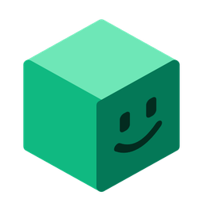
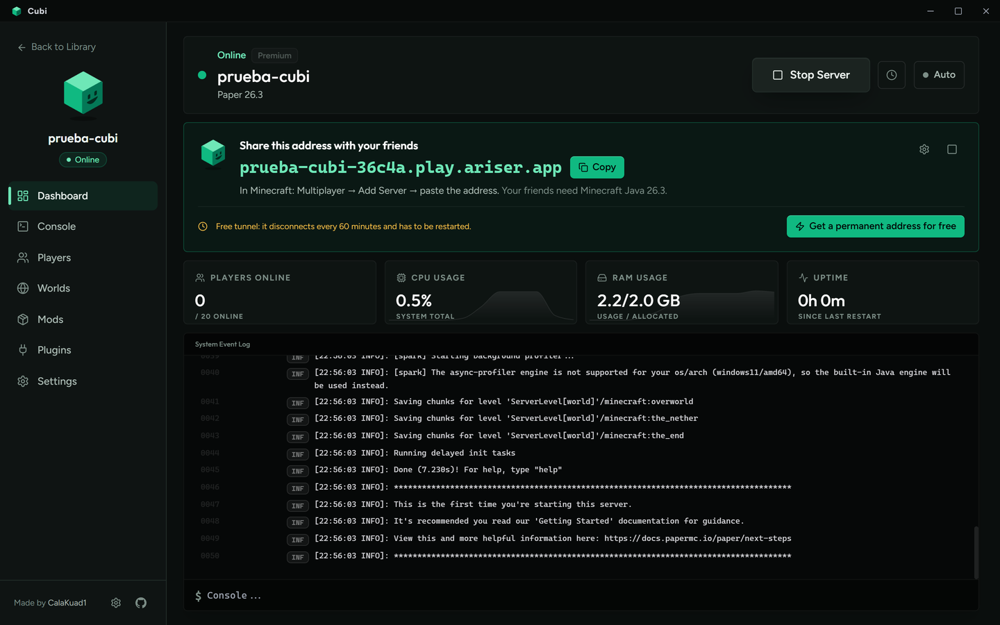
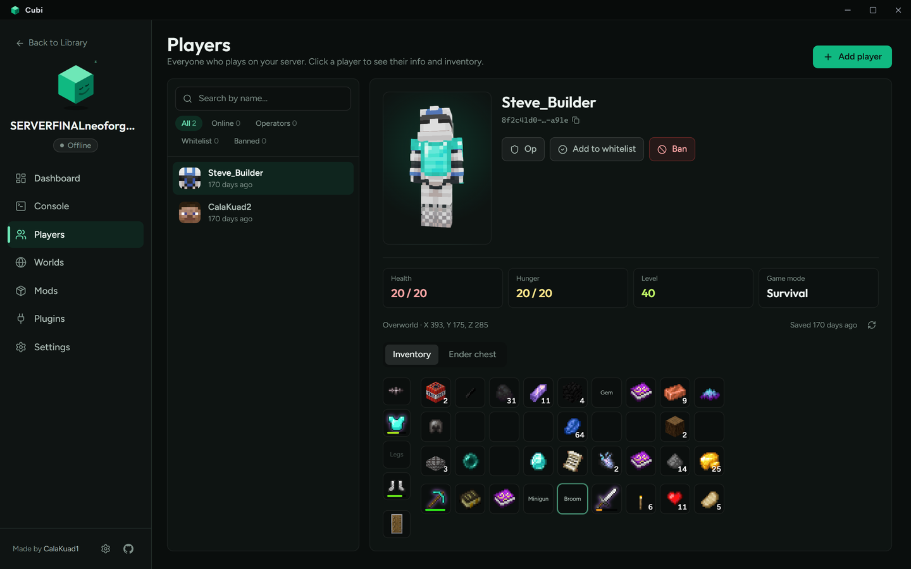
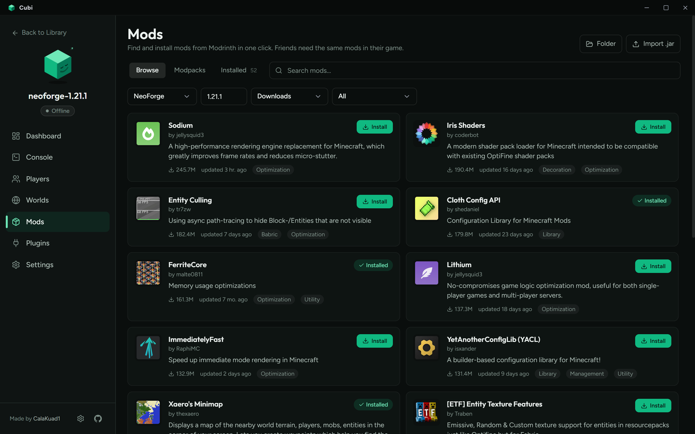
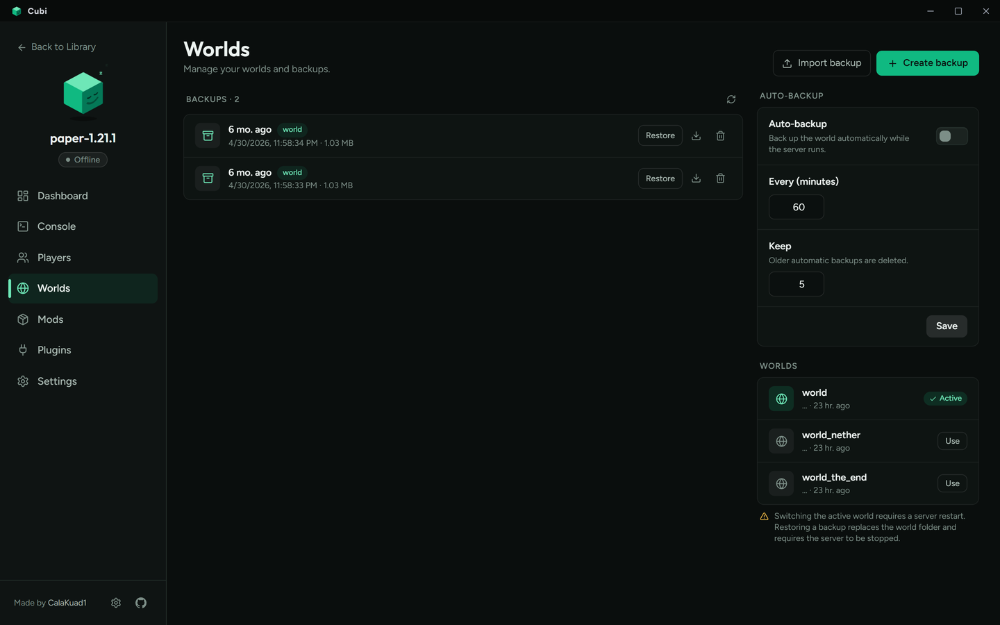
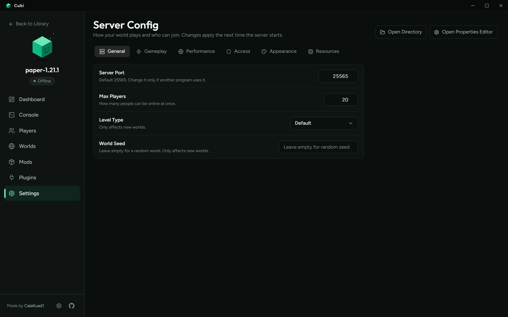
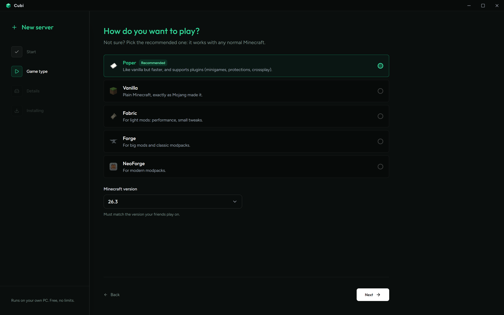
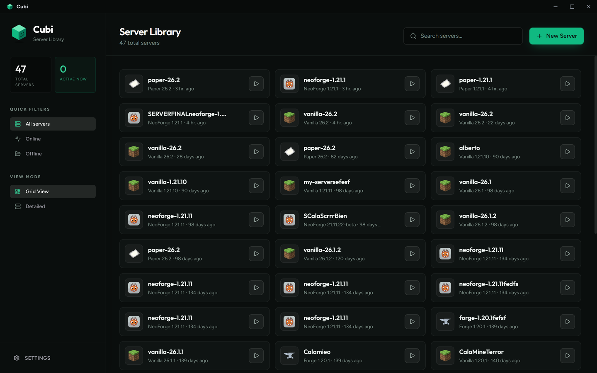

<div align="center">
  

  <h1>Cubi — Minecraft Local Server GUI</h1>

  <p><strong>Host a Minecraft server on your own PC and play with your friends in a minute.<br>Free, no limits, no port forwarding.</strong></p>

  <p>
    <a href="https://github.com/CalaKuad1/Minecraft-Local-Server-GUI/releases/latest">
      
    </a>
    <a href="https://github.com/CalaKuad1/Minecraft-Local-Server-GUI/releases/latest">
      
    </a>
  </p>

  <p>
    
    
    
    
  </p>

  <br>
  
</div>

---

## How it works

1. **Create** — pick how you want to play (Vanilla, Paper plugins, Fabric/Forge/NeoForge mods). Cubi downloads the server and the right Java for you.
2. **Start** — the server starts by itself and gets a public address. No router setup.
3. **Share** — copy the address and send it to your friends. They paste it in *Multiplayer → Add Server*.

## Features

| | |
|---|---|
| **Play with friends from anywhere** | Public address in one click, a **free permanent address** with playit.gg, or a fixed `name.play.ariser.app` address. No port forwarding. |
| **Players** | Everyone who joined, with a **3D skin wearing their armor**, stats, inventory and ender chest with real item icons (vanilla *and* modded). Op, whitelist, kick and ban in one click. |
| **Mods & plugins** | Search and install from Modrinth, modpacks included. Installed list with readable names. |
| **Worlds & backups** | Automatic backups on a schedule, restore, download or import in one click. |
| **Simple settings** | Every option explained in plain words, RAM presets, live MOTD preview. |
| **Automatic Java** | The correct Java for each Minecraft version is downloaded and kept separate from your system. |
| **Bedrock crossplay** | With GeyserMC, phone and console players can join your Java server. |
| **4 languages** | English, Spanish, French and Russian. |

<details>
<summary><strong>More screenshots</strong></summary>
<br>

| | |
|:--:|:--:|
| <br><sub>Players</sub> | <br><sub>Mods</sub> |
| <br><sub>Worlds & backups</sub> | <br><sub>Settings</sub> |
| <br><sub>Setup wizard</sub> | <br><sub>Your servers</sub> |

</details>

## Download

| Platform | |
|:--|:--|
| **Windows 10/11** (64-bit) | `.exe` installer |
| **Linux** | `.AppImage` or `.deb` |

[Download the latest version](https://github.com/CalaKuad1/Minecraft-Local-Server-GUI/releases/latest). Already using MLSG 1.x? The app will update to Cubi and keep your servers and settings.

No Python or Java needed. See the [changelog](CHANGELOG.md) for what's new.

## FAQ

<details>
<summary><strong>Do my friends need to install anything?</strong></summary>

Only Minecraft Java Edition (the same version as your server). With mods, they need the same mods too. Bedrock players can join if you install GeyserMC.
</details>

<details>
<summary><strong>Do I need to open ports on my router?</strong></summary>

No. Cubi creates a public tunnel automatically. Link a free playit.gg account once to get a permanent address with no time limit; otherwise a temporary Pinggy tunnel (60-minute sessions) is used.
</details>

<details>
<summary><strong>Why does it download Java and game graphics?</strong></summary>

Each Minecraft version needs a specific Java; Cubi downloads it into its own folder without touching your system. Item icons and skins are generated on your PC from the official game files downloaded from Mojang, once per version — Cubi doesn't ship any Mojang artwork.
</details>

<details>
<summary><strong>Where are my servers and settings stored?</strong></summary>

Servers live in the folder you choose (default `~/MinecraftServers`). App data is in `%APPDATA%/MinecraftServerGUI` on Windows and `~/.minecraft_server_gui/` on Linux.
</details>

<details>
<summary><strong>Can I import a server I already have?</strong></summary>

Yes: *New server → I already have a server*, then choose its folder. The type and version are detected automatically.
</details>

## Development

```bash
git clone https://github.com/CalaKuad1/Minecraft-Local-Server-GUI.git
cd Minecraft-Local-Server-GUI

# Backend (Python 3.11+)
cd backend
python -m venv venv
venv\Scripts\activate          # Windows  (Linux: source venv/bin/activate)
pip install -r requirements.txt

# Frontend (Node 18+)
cd ../electron-app
npm install
npm run dev
```

**Releases** are built by GitHub Actions: bump `electron-app/package.json`, then push a tag (`git tag v2.0.0 && git push origin v2.0.0`). Tags with a suffix such as `-beta.1` are published as pre-releases.

| Layer | Technology |
|---|---|
| App | Electron + React + Vite + Tailwind |
| Backend | Python + FastAPI |
| Packaging | electron-builder + PyInstaller (GitHub Actions) |

## License

[MIT](LICENSE). Made by [CalaKuad1](https://github.com/CalaKuad1). If Cubi helps you, starring the repo helps others find it.

<sub>Cubi is not an official Minecraft product. Not approved by or associated with Mojang or Microsoft.</sub>
